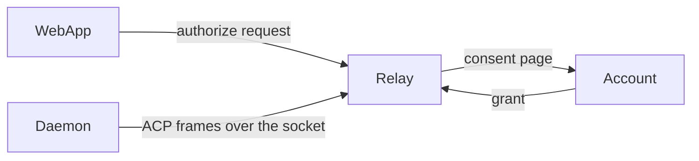
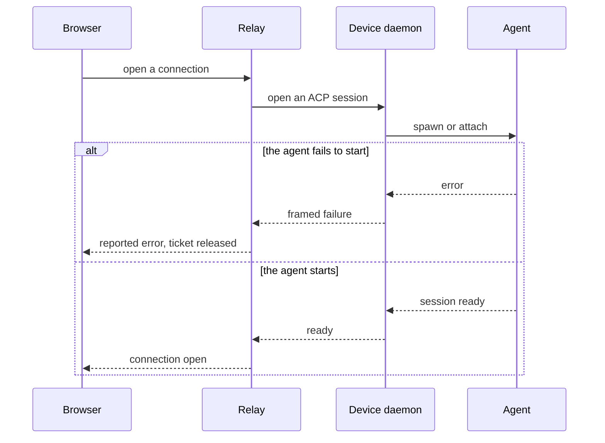
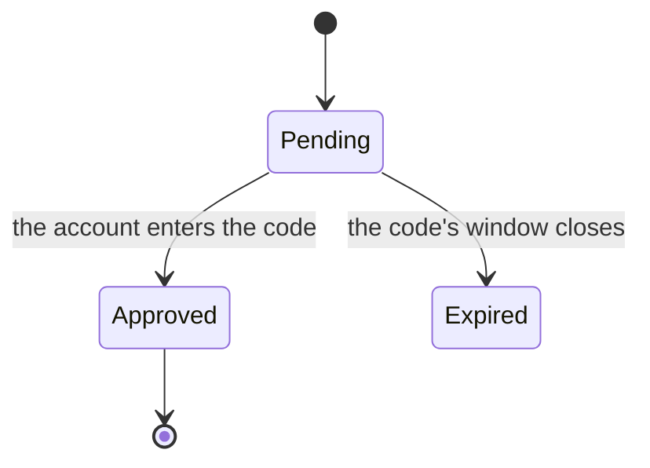

# Pull request body template

A decision guide, not a form. `## Summary` and `## Verification` always apply. Every other section earns its place by making this change easier to review; drop the rest, and never write filler to fill a heading.

## Summary

The problem or capability first, the result second, the reason for this approach third.

- What behavior changed, for a person or a system?
- Why does this change belong in one PR?
- Is it independent, or stacked on another branch? If stacked, name the parent and keep inherited changes out of the description.

## Change map

Adding, moving, or removing a responsibility across modules, packages, or ownership boundaries. Not a changed-file list.

| Module | Before | After | Description |
| --- | --- | --- | --- |
| `<module or boundary>` | `<previous responsibility or behavior>` | `<new responsibility or behavior>` | `<reason and effect>` |

Add a small responsibility tree only when it makes the scope easier to read:

```text
apps/relay/src/
├── server/identity/   # Account, sign-in, consent, device approval
├── server/devices/    # Device records and their last-seen state
├── server/routes/     # HTTP surfaces over the domain
└── web/               # Dashboard and account pages
```

## Architecture and behavior

### Module flow

A cross-module feature or a boundary change:



### Behavior flow

Observable ordering, asynchronous work, events, or cleanup:



Name the state owner and the key that isolates concurrent work — a device id, a ticket, a session id — when they carry the correctness.

### Before and after, for a fix

Use a pair when structure, ordering, or state explains the fault. Keep both diagrams structurally comparable, and then state the exact edge, step, owner, or transition that changed. Do not make the reader diff the diagrams.



When a reviewer would expect a diagram and none applies, say so in one line: `Not applicable: this change updates <copy, a constant, a local name> and does not change runtime flow.`

## Boundaries and risks

Only the risks this diff actually creates.

| Invariant or boundary | Failure mode | Protection | Evidence or gap |
| --- | --- | --- | --- |
| `<required behavior>` | `<timeout, replay, race, invalid input, partial write>` | `<guard, ownership rule, cleanup path>` | `<test, runtime evidence, or unverified>` |

Groups worth checking against this codebase:

- Tokens and scopes: which credential the change accepts, what it authorizes, and what happens when it is expired, replayed, or from another account.
- The consent and device-approval flow: a code or link reused, a forwarded link, an approval that lands after the request is gone.
- Persistence: the SQLite schema and data written by a build that a rollback would read.
- ACP frames and sockets: ordering, cancellation, a daemon that drops mid-frame, one gateway process per connection.
- Secrets and logs: what a token, cookie, device code, or account row can reach in a log line or an error body.
- UI states: loading, empty, failed, offline, stale, and repeated action — including the narrow viewport.

Mark an unanswered question as `Not verified`. Do not turn it into a claim.

## Verification

The commands, and what they printed.

```text
pnpm test
pnpm build
pnpm --filter @mukae/relay test
```

Keep the kinds of evidence apart:

- a focused test proves the behavior it exercises
- `pnpm build` and the typecheck prove static checks, and nothing about runtime
- the preview workflow proves the packages publish, not that they work
- a driven flow or screenshot proves only the state that was on screen
- manual acceptance proves only the scenario that was performed

List what stayed unverified. A check that passed elsewhere does not cover it.

## Visual changes

Every user-visible surface the diff touches, as a before/after pair. Produce the images before writing this section (see [visual-evidence.md](visual-evidence.md)) and upload each one as a user asset.

| Before | After |
| --- | --- |
|  |  |
| `<surface, state, viewport, theme>` | `<surface, state, viewport, theme>` |

`Absent` for a surface the change adds, `Removed` for one it deletes. A state that could not be captured is listed with its reason, not omitted.

## Rollout and follow-up

Migrations, feature gates, known gaps, a required follow-up PR. State whether a gap blocks the merge or belongs to another task — do not leave incomplete work implied.
