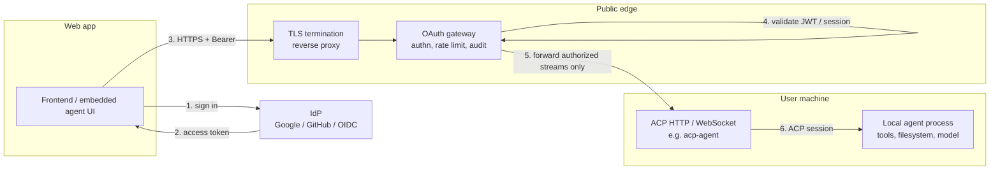

# Architecture

## Components

| Component | Responsibility |
|---|---|
| Web app | Sign-in, UI, opens ACP connection to the gateway |
| IdP | Issues access tokens (OIDC / OAuth 2.1) |
| TLS edge | Terminates TLS; the gateway speaks plain HTTP/WS behind it |
| OAuth gateway | Resource-server behavior: token validation, tenant mapping, rate limits, audit log |
| ACP transport | HTTP/SSE or WebSocket adapter in front of the agent |
| Local agent | Runs tools; trusts only the gateway |

## Trust boundaries

- Public internet to gateway: authenticated, rate limited.
- Gateway to local ACP endpoint: loopback or private tunnel only.
- Local agent to host: the agent's own sandbox and permission prompts apply.

## Principles

- One ACP session per authenticated user (or per user and workspace). No shared sessions.
- The gateway holds identity; ACP carries conversation and tool traffic only.
- Deny by default: unknown users, unknown scopes, and unknown origins are rejected.
