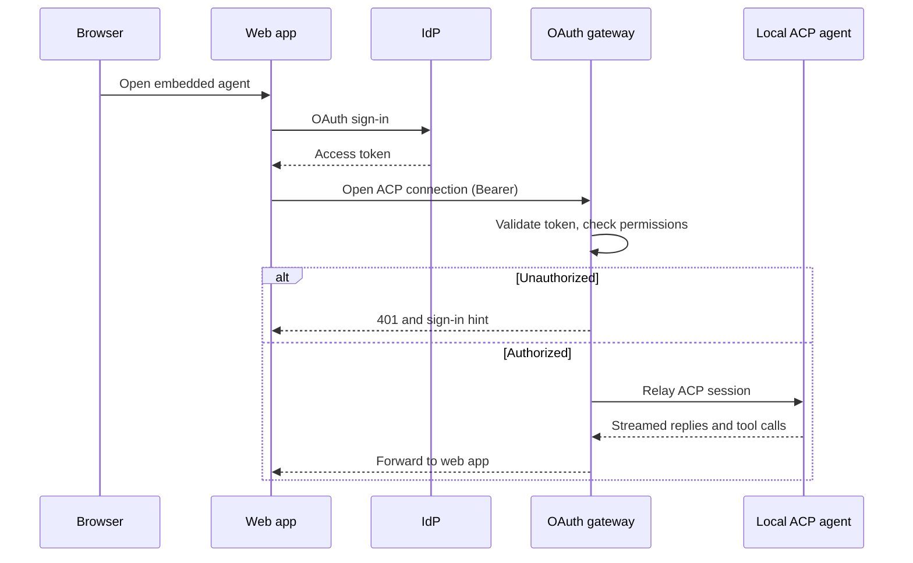

# Auth flow

## Rules

- Tokens are validated at the gateway. They are never forwarded into the ACP session or into model context.
- Browsers cannot set WebSocket headers. Prefer a short-lived, single-use connection ticket over putting the long-lived token in the URL.
- ACP URL-mode elicitation (for out-of-band OAuth the agent itself needs) is separate from user-to-gateway auth.
