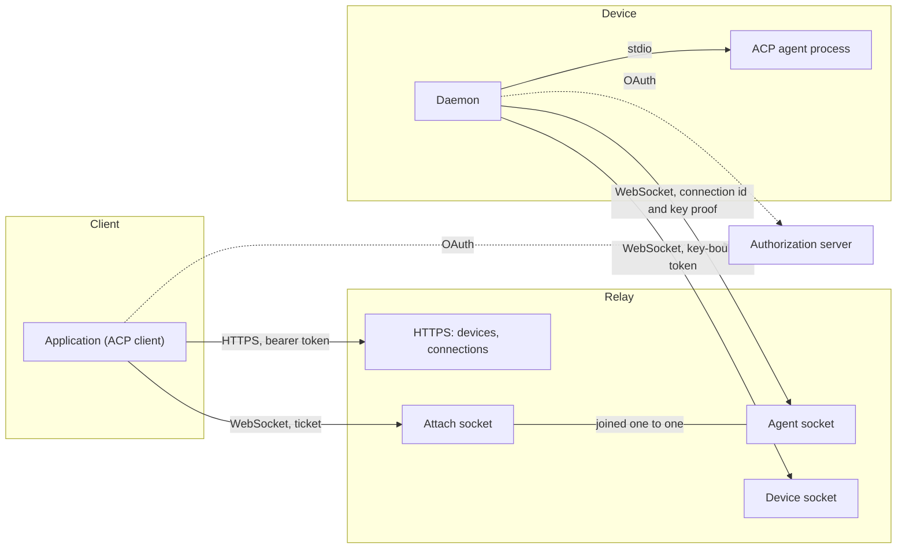
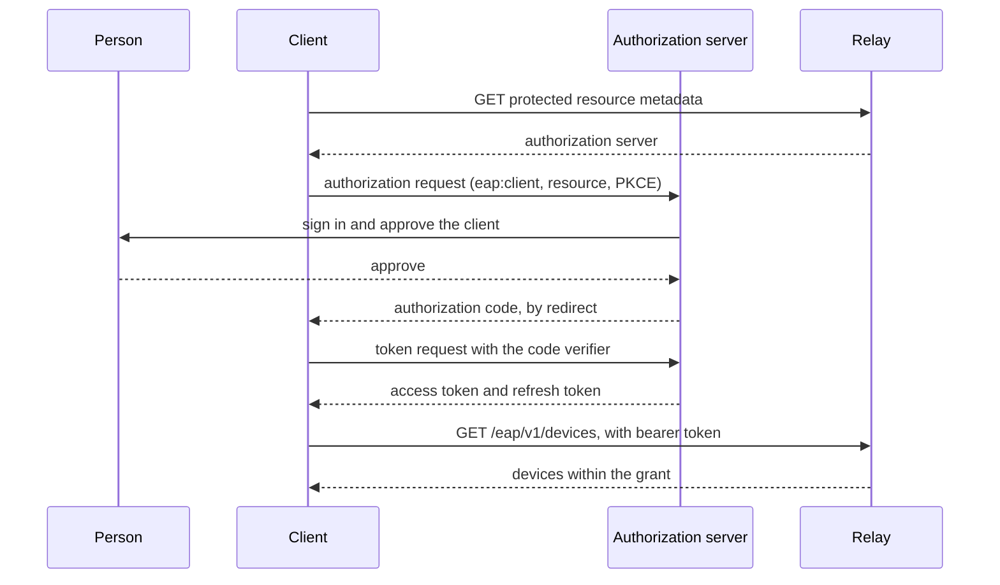
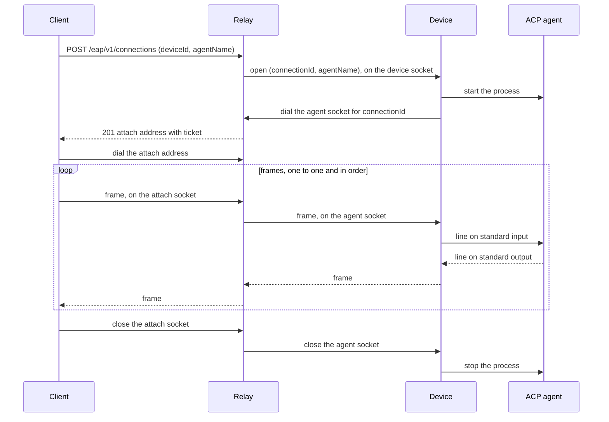
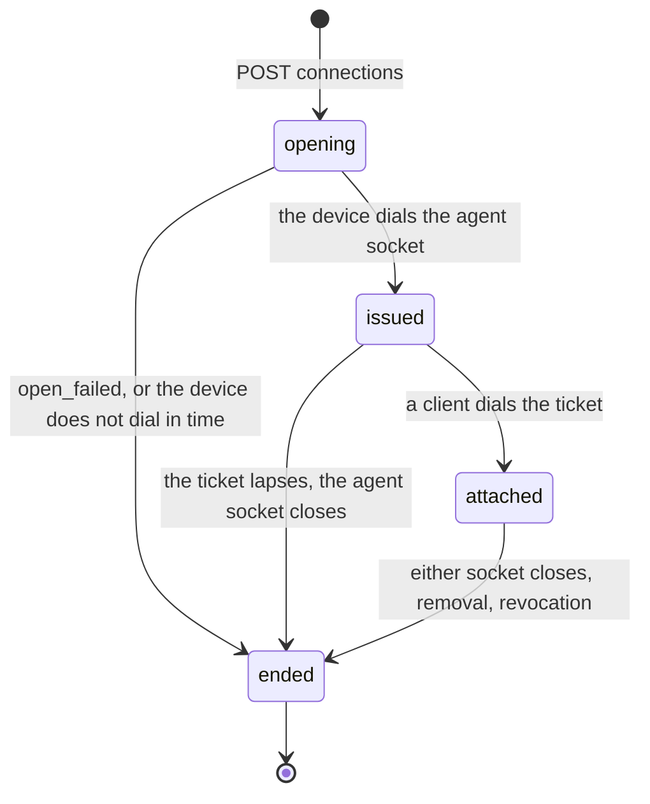

# Exterior Agent Protocol

Version 1. Draft.

Exterior Agent Protocol (EAP) lets an application reach an [Agent Client Protocol (ACP)](https://agentclientprotocol.com) agent that runs on a machine its user owns. Both sides connect to a relay. The machine never accepts an inbound connection.

The key words MUST, MUST NOT, SHOULD, SHOULD NOT and MAY are used as in RFC 2119. All JSON is UTF-8. Times are RFC 3339 in UTC.

## 1. Overview



A device keeps one device socket open to the relay. It carries only control messages: the device announces its agents, and the relay asks it to start one. A client opens a connection over HTTPS. The device starts the agent and dials an agent socket for that connection alone; the client dials an attach socket with a ticket. The relay joins the two sockets and passes frames between them. Each connection has its own pair of sockets, so connections never share a queue.

EAP carries ACP messages without reading them. It specifies how a relay is found and how clients and devices sign in to it, how a device announces its agents, how a connection opens, carries frames and ends, and its errors and close codes.

EAP does not specify how an account is created, how a person logs in, what a consent screen looks like, how a person chooses which devices a client may reach, how an agent is installed, or anything inside an ACP message.

## 2. Terms

**Account**: the person on whose behalf clients and devices act. The relay learns it from a token.

**Relay**: the party both other roles connect to. It keeps the online devices and the live connections, and joins sockets.

**Client**: an application that lists devices and opens connections. A client is an ACP client. A web app is a client.

**Device**: a key a machine holds for one relay, signed in to one account, and the daemon that runs under it. Its device id is the key's thumbprint. A machine keeps one key per relay, and one key signed in to two accounts is a device of each.

**Device software**: the program a device runs, such as a daemon. It is one OAuth client however many devices run it.

**Agent**: an ACP agent a device can start. A device offers it under an agent name.

**Connection**: one running agent process, reached through one attach socket and one agent socket. It is one ACP connection: one `initialize`, and as many ACP sessions as the agent supports. It ends when either socket closes, and is never resumed.

**Device socket**: the device's one WebSocket to the relay, for control messages.

**Agent socket**: the WebSocket a device dials for one connection, carrying its agent's frames.

**Attach socket**: the WebSocket a client dials for one connection, with a ticket.

**Frame**: one WebSocket text message carrying one ACP JSON-RPC message.

**Ticket**: a single-use, short-lived secret that lets one attach socket join one connection.

**Grant**: the set of devices an account lets a client reach.

## 3. Addresses

A relay is identified by an origin, the relay address. Every endpoint is at a fixed path under it:

| Endpoint | Path |
| --- | --- |
| Protected resource metadata (RFC 9728) | `GET /.well-known/oauth-protected-resource` |
| Devices | `GET /eap/v1/devices` |
| Connections | `POST /eap/v1/connections` |
| Device socket | `wss:` `/eap/v1/device` |
| Agent socket | `wss:` `/eap/v1/device/connections/{connectionId}` |

The attach address is not fixed: the relay returns it when a connection opens.

The protected resource metadata names the relay address as `resource`, which every token request passes as the resource indicator (RFC 8707). It lists at least one `authorization_servers` entry, `scopes_supported` including `eap:client` and `eap:device`, and `dpop_signing_alg_values_supported`. A client or device reads the authorization server's own metadata from there, as RFC 8414 or, failing that, OpenID Connect Discovery.

A frame is at most 1 MiB (1,048,576 bytes) of UTF-8.

## 4. Authorization

EAP uses OAuth 2.1 access tokens. Every request to the devices and connections endpoints, and the device socket upgrade, carries one: `Authorization: Bearer <token>`, or, for a token bound to a key, `Authorization: DPoP <token>` with a `DPoP` proof (RFC 9449). A device's tokens are always bound to its key. An attach socket carries a ticket, and an agent socket its connection id and a proof of the device's key, instead.

A proof names the request it is for. A socket's proof names the http or https form of the socket's address, which is the request that upgrades it, and the relay checks it against its own public address.

A request without a valid token is answered 401 with `WWW-Authenticate: Bearer resource_metadata="<address of the protected resource metadata>"`. A client MUST check the `iss` of an authorization response (RFC 9207).

### 4.1 Scopes

- `eap:client`: the holder is a client. It may list devices and open connections within its grant.
- `eap:device`: the holder is a device. It may open the device socket.

The relay MUST NOT accept a token on an endpoint its scope does not name, and answers it 403 with `insufficient_scope`. It MUST NOT let one OAuth client hold both scopes. `offline_access` MAY be requested to receive a refresh token.

### 4.2 Clients

A client signs in with the authorization code flow with PKCE (S256), requesting `eap:client` and the relay's `resource`. It identifies itself, in this order of preference, by a client id the relay issued, by the address of its Client ID Metadata Document, or by registering at the authorization server's registration endpoint (RFC 7591) with the authorization code grant. A relay supports at least one of these and SHOULD support metadata documents. A client MAY bind its tokens to a key of its own with DPoP.



### 4.3 Devices

Device software is one OAuth client, named by a client id the relay issued or by the address of its Client ID Metadata Document. Its metadata has `grant_types` `["urn:ietf:params:oauth:grant-type:device_code", "refresh_token"]`, `token_endpoint_auth_method` `none` and `dpop_bound_access_tokens` `true`. Each device running it is a key:

1. The device makes a key pair for the relay and keeps the private key to itself.
2. It signs in with the device authorization grant (RFC 8628), requesting `eap:device`, `offline_access` and the relay's `resource`. The person approves the code. Every token request carries a DPoP proof of the key, so the access token and the refresh token are bound to it (`cnf.jkt`).
3. It keeps the key across sign-outs, so signing in again is the same device. A new key is a new device.

The device id is the key's JWK thumbprint (RFC 7638), which is the token's `cnf.jkt`. A device never states its id on the wire, and nobody can act as a device without its key: knowing its id, or holding a token stolen from it, is not enough.

The relay MUST issue `eap:device` only through the device authorization grant, and only to a client that cannot sign in through a browser. It MUST refuse `eap:device` on a token that is not bound to a key. It MUST open a device socket only while the account still has a sign-in for the key: a refresh token bound to it that is neither revoked nor expired.

```mermaid
sequenceDiagram
  participant Person
  participant Device
  participant Auth as Authorization server
  participant Relay

  Device->>Device: make a key; its thumbprint is the device id
  Device->>Relay: GET protected resource metadata
  Relay-->>Device: authorization server
  Device->>Auth: device authorization request (device software's client id, eap:device)
  Auth-->>Device: device code and user code
  Person->>Auth: open the address, check the code, approve
  loop until approved
    Device->>Auth: token request with the device code and a DPoP proof
  end
  Auth-->>Device: access token and refresh token, bound to the key
  Device->>Relay: open the device socket, with the token and a DPoP proof
  Device->>Relay: hello
```

### 4.4 Grants

A grant is the set of devices a client may reach. How the person chooses it is outside EAP; it may be every device of the account. A granted device includes every agent it offers, including agents added to it later.

The relay MUST check the grant on every request, not only when it issues a token: a device outside the grant is absent from the device list and is answered `target_not_found` when named. A client whose grant was revoked reaches no device, even with an access token that has not expired.

### 4.5 Removal and revocation

A socket MUST NOT outlive the authorization that opened it.

- When a device is removed from the account, the relay ends its sign-in: it deletes every refresh token bound to its key, so the access token the device still holds no longer opens a device socket. It closes the device socket with `revoked`, and ends the device's connections: their agent sockets close, and their attach sockets close with `device_gone`.
- When a client's grant is revoked, or narrowed so it no longer covers a device, the relay closes each attach socket it no longer permits with `revoked`.

An access token that expires while a socket is open does not close the socket.

## 5. Errors

An error response has an HTTP status and a JSON body:

```json
{ "code": "target_not_found", "message": "That device is not online." }
```

`code` is stable and machine-readable. `message` is for people and may change. A client decides by `code`, and treats one it does not know as `server_error`.

| Code | Status | Meaning |
| --- | --- | --- |
| `invalid_request` | 400 | A field is missing, malformed or too long. |
| `unauthorized` | 401 | The token is missing, expired or revoked. |
| `insufficient_scope` | 403 | The token's scope does not allow this endpoint. |
| `target_not_found` | 404 | The device is not online, does not offer the agent, or is outside the grant. These cases MUST NOT be distinguishable. |
| `agent_start_failed` | 502 | The device could not or would not start the agent. `message` is the device's reason. |
| `device_timeout` | 504 | The device did not dial the agent socket in time. |
| `server_error` | 500 | The relay failed. |

## 6. HTTP API

All bodies are JSON. Names are camelCase.

### 6.1 Devices

`GET /eap/v1/devices` returns the online devices within the caller's grant:

```json
{
  "devices": [
    {
      "id": "d8f0c2a1...",
      "hostname": "studio-mac",
      "platform": "macos",
      "workingDirectory": "/Users/person/.local/share/exterior/workspace",
      "agents": [{ "name": "claude", "agentType": "claude-acp" }]
    }
  ]
}
```

- `id` is the device id.
- `hostname` is 1 to 256 characters.
- `platform` is `macos`, `windows` or `linux`. A client MUST tolerate other values.
- `workingDirectory` is a directory on the device, in the device's own path syntax, that its agents start in. It is a hint, not a boundary (section 12).
- `agents[].name` is unique on the device, 1 to 128 characters, with no CR, LF or tab. `agentType` matches `^[a-z][a-z0-9-]{0,63}$` and is the agent's ACP Registry id when it has one. The relay does not interpret it.

The list is a snapshot. A client that wants fresh state asks again.

### 6.2 Connections

`POST /eap/v1/connections` with `{ "deviceId": "...", "agentName": "..." }` opens a connection.

The relay checks the scope and the grant, finds the online device and its agent, and sends the device `open`. It answers once the device has dialed the agent socket, 201:

```json
{
  "agentType": "claude-acp",
  "url": "wss://relay.example.com/eap/v1/attach?ticket=...",
  "expiresAt": "2026-10-21T08:00:00Z"
}
```

`url` is the attach address, carrying the ticket. `expiresAt` is when the ticket lapses. The relay answers `agent_start_failed` when the device sends `open_failed`, and `device_timeout` when the agent socket does not arrive within a bound it chooses; 15 seconds is recommended. Other errors: `invalid_request`, `target_not_found`.



A connection has no other HTTP operation. A client ends it by closing its socket.

## 7. Connection lifecycle



- `opening`: the device was asked to start the agent.
- `issued`: the agent runs, its agent socket is open, and the ticket is out.
- `attached`: the attach socket is joined to the agent socket, and frames flow.

When a connection ends the relay closes whichever of its sockets is still open, and the device stops the agent. An attached connection has no time limit.

A connection does not depend on the device socket. A device whose device socket drops and reconnects keeps its running agents and their agent sockets.

**Reconnecting.** A connection is never resumed. A client that loses its socket, and a page that reloads, opens a new connection and sends `initialize` on it. It continues a conversation with ACP `session/resume` or `session/load`, when the agent advertises them. A request that had no response when the socket closed has no outcome the client can learn: the agent was stopped, and may have done part of it.

## 8. Frames and flow

The attach socket and the agent socket carry frames under the same rules.

- Each WebSocket text message is one frame, and each frame carries one ACP JSON-RPC message without a raw newline.
- Binary messages are refused: the relay closes the socket with 1003. A frame larger than 1 MiB closes it with 1009.
- The relay passes frames between the two sockets one to one, in order, without joining, splitting, dropping or reading them, and sends nothing else on them.
- The relay does not read the agent socket until a client attaches, so an agent that writes first waits instead of the relay holding its output.
- When one socket has more unsent data than a bound the relay chooses, at least 1 MiB, the relay stops reading the other until it drains. A slow client slows its own agent and nothing else.

## 9. Attach socket

A client dials the attach `url` as a WebSocket. It sends no `Authorization` header: the ticket in the address is the credential, because a browser socket cannot set one.

- A ticket is bound to one connection and is single-use: dialing it consumes it.
- It lapses at `expiresAt`; 60 seconds after it is issued is recommended. It has at least 128 bits of randomness.
- A ticket that is used, expired or unknown is answered by closing the socket with `ticket_rejected`. A client that still wants an agent opens a new connection.

A client MUST dial each ticket at most once. A client that may mount twice, such as a page under a framework that remounts components, keeps one socket per connection itself. A second dial does not reach the agent; it costs a second connection.

An ACP client with a WebSocket transport can use the attach address as its agent address as it stands.

## 10. Device socket

A device opens the device socket with its key-bound access token, which has `eap:device`, and a DPoP proof. A device has at most one device socket: a newer one closes the older with `replaced`. While its device socket is open the device is online.

Every message is a JSON text message with a `type` field. A receiver MUST ignore a message type or a field it does not know. A message of a known type that does not follow this section closes the socket with `invalid_message`.

### 10.1 Device to relay

`hello`: sent first, and again whenever any field changes. It replaces what the relay knew about the device. Any other message before the first `hello` is invalid.

```json
{
  "type": "hello",
  "hostname": "studio-mac",
  "platform": "macos",
  "workingDirectory": "/Users/person/.local/share/exterior/workspace",
  "agents": [{ "name": "claude", "agentType": "claude-acp" }]
}
```

`workingDirectory` is 1 to 4096 characters, and `agents` lists at most 32 agents. A change to `agents` does not end running agents.

`open_failed`: `{ "type": "open_failed", "connectionId": "...", "message": "..." }`. The agent did not start. `message` is 1 to 500 characters. The relay ignores one for a connection that is no longer opening.

### 10.2 Relay to device

`open`: `{ "type": "open", "connectionId": "...", "agentName": "..." }`. The device starts that agent and dials its agent socket, or answers `open_failed`. It answers `open_failed` for an agent it does not offer. It ignores an `open` for a connection id it already holds.

`connectionId` is base64url, 22 to 128 characters, with at least 128 bits of randomness.

## 11. Agent socket

Once the agent has started, the device dials `/eap/v1/device/connections/{connectionId}` with a DPoP proof of its key and no access token. The relay answers a dial without a valid proof 401. It accepts one dial for a connection, while the connection is opening, and only from the device it was opened on: the proof's key thumbprint is the connection's device id. It closes any other dial with 1008. The connection id is unguessable and reaches only the device, but it is not enough alone.

- The device closes the agent socket with 1000 when the agent ends, and the relay closes the attach socket with `agent_exited`. A device that shuts down closes it with 1001. When the agent socket closes any other way than with 1000, the relay closes the attach socket with `device_gone`.
- When the connection ends for any other reason the relay closes the agent socket, and the device stops the agent.

### 11.1 Agent carriage

The device runs the agent as an ACP stdio agent, in the directory it reported as `workingDirectory`.

- A frame from the agent socket is written to the agent's standard input followed by a newline. The device ignores a frame that contains a raw newline.
- The device reads standard output as UTF-8, replacing invalid sequences with U+FFFD. Each line is a frame, without its line ending: LF, or CR LF. Empty lines are dropped.
- A device stops an agent that writes a line longer than a frame.
- The device stops reading standard output while the agent socket has more than 1 MiB unsent, and stops reading the agent socket while standard input is full.
- Standard error is not forwarded.

Which directory an ACP session works in is the client's request inside ACP, not an EAP field.

## 12. Heartbeat and close codes

The relay MUST ping every socket, and a device MUST ping every socket it opens, every 30 seconds with a protocol-level ping. A side whose previous ping is unanswered when the next is due MUST terminate the socket. A browser cannot send a ping; it answers the relay's.

Each code is unique across EAP and each socket kind has its own range, so a code names the socket and the condition in a log. The reason string is the name.

Attach socket, 4100 to 4199. Every close ends the connection.

| Code | Name | Meaning |
| --- | --- | --- |
| 4100 | `ticket_rejected` | The ticket is used, expired or unknown. Open a new connection. |
| 4101 | `agent_exited` | The agent ended. |
| 4102 | `device_gone` | The agent socket dropped, the device shut down, or the device was removed. |
| 4103 | `revoked` | The client's grant no longer permits this connection. Do not open another before signing in again. |

Device socket, 4200 to 4299:

| Code | Name | Meaning |
| --- | --- | --- |
| 4200 | `replaced` | A newer device socket for this device took over. |
| 4201 | `revoked` | The device was removed. It must sign in again. |
| 4202 | `invalid_message` | The device sent a message that does not follow section 10. |

Agent socket: 1000 when the connection ends normally, 1001 when the device shuts down, and 1008 for a dial the relay is not waiting for or that comes from another device.

Every socket: 1003 for a binary message and 1009 for a frame larger than 1 MiB.

An upgrade refused before the socket opens is answered 401 or 403 as in section 4. A device told `revoked` MUST NOT reconnect until it signs in again. A device told `replaced` SHOULD wait the longest of its retry delays before connecting again.

## 13. Deployment

A relay keeps devices and connections in memory. One relay address is served by one process, or by several that route every request for a device or a connection to the process that holds its sockets and share the store of DPoP proofs already seen, so a proof cannot be replayed against another process. A relay that restarts ends every connection: devices connect again, and clients open new connections as in section 7.

## 14. Security considerations

**The grant is the trust boundary.** A client within its grant can run the granted devices' agents with the device owner's permissions. The relay MUST present this to the person when they approve a client: which client, that it can act with their permissions, and that it reaches agents added to a device later.

**`cwd` is not a boundary.** ACP carries a working directory in `session/new` and similar requests. The device does not read ACP messages, and an agent can read any path its user can. A device that needs a boundary runs the agent inside an operating-system sandbox. ACP tool permission requests protect against a misbehaving agent, not a malicious client, because the client answers them.

**`workingDirectory` names a path.** It often contains the person's user name on the device, and every client in the grant reads it.

**The relay sees every frame in plaintext.** EAP has no end-to-end encryption. A person who does not trust a relay does not point their devices at it.

**Tickets and connection ids** appear in a URL, which may be logged. Both are single-use, short-lived and unguessable, and a connection id is useless without the device's key. A relay SHOULD NOT log the query string of an attach address.

**Roles are separate, and a device is its key.** The scope check in section 4.1 stops a client from posing as a device and receiving the frames of connections opened on it. A device's id is the key its tokens are bound to, so no client, and no other device of the account, can take its place, even one that learned its id from the device list.

**No ambient credentials.** Every endpoint takes an access token, a ticket, or a connection id with a key proof, never a cookie, so a relay may allow cross-origin calls from any origin.

**Registration is open.** Anyone can register a client. A relay SHOULD delete registrations nobody approved.

**Device authorization can be phished.** A person tricked into approving someone else's code signs in that person's device, with its own key: it appears as a new device of the account, and cannot take the place of one already there. The approval page MUST show the user code to compare with the device's and the account that will hold the device, and tell the person to deny a code they did not start.

## 15. Versioning

The version is in every endpoint path: this document is `/eap/v1/`. Within a version, changes are additive: new optional fields, new message types, new error codes. A receiver ignores what it does not know, except an unknown error `code`, which it treats like `server_error`. A later version that changes an endpoint serves it under a new path, and a relay that does not speak a version answers its paths 404.

## 16. Conformance

A relay, a client or a device conforms when it meets every MUST and MUST NOT in this document addressed to it. SHOULD statements are recommendations and do not affect conformance.
