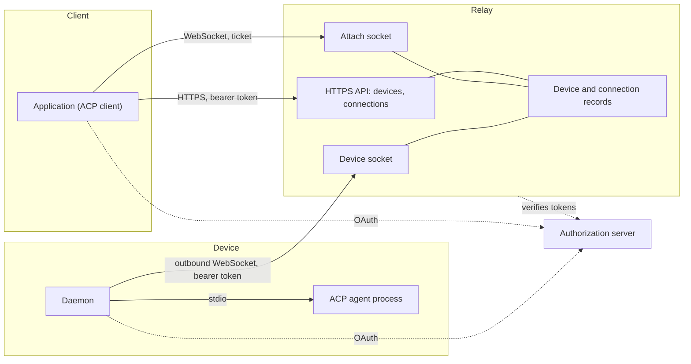
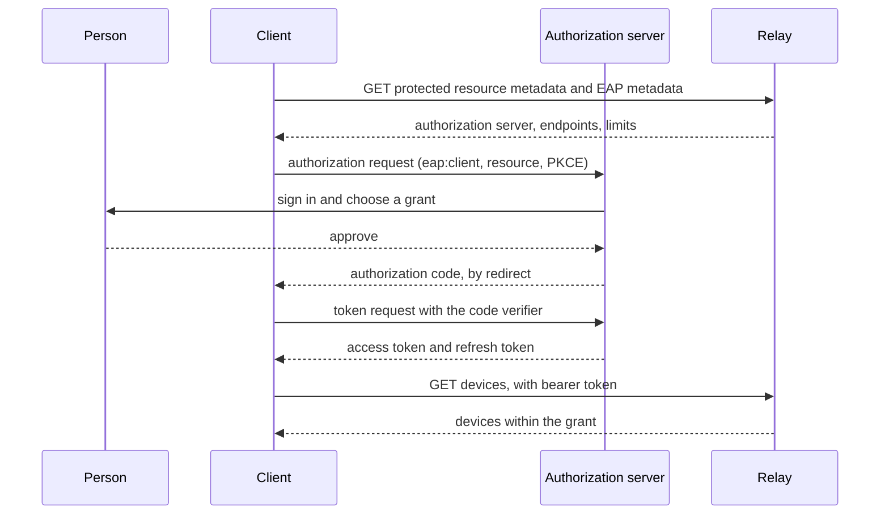
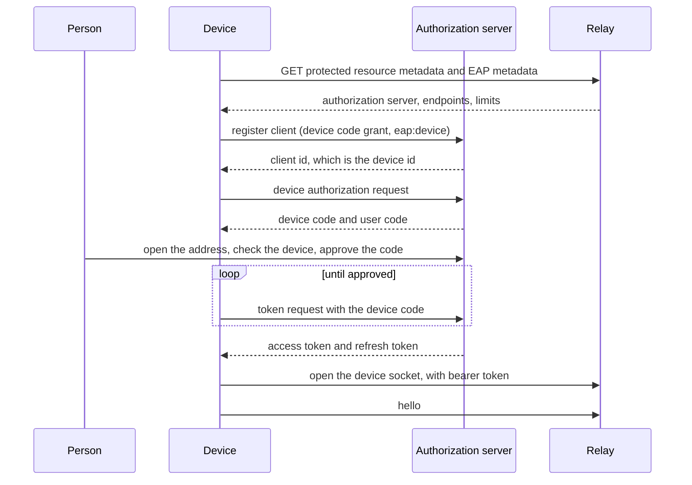
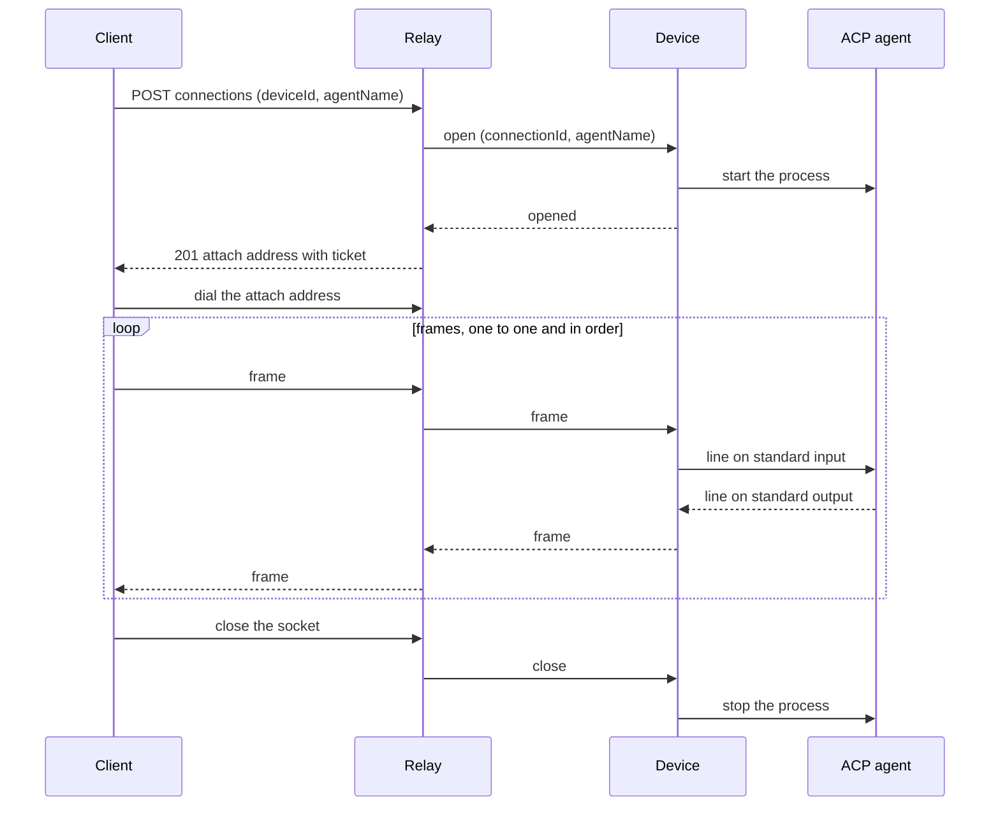
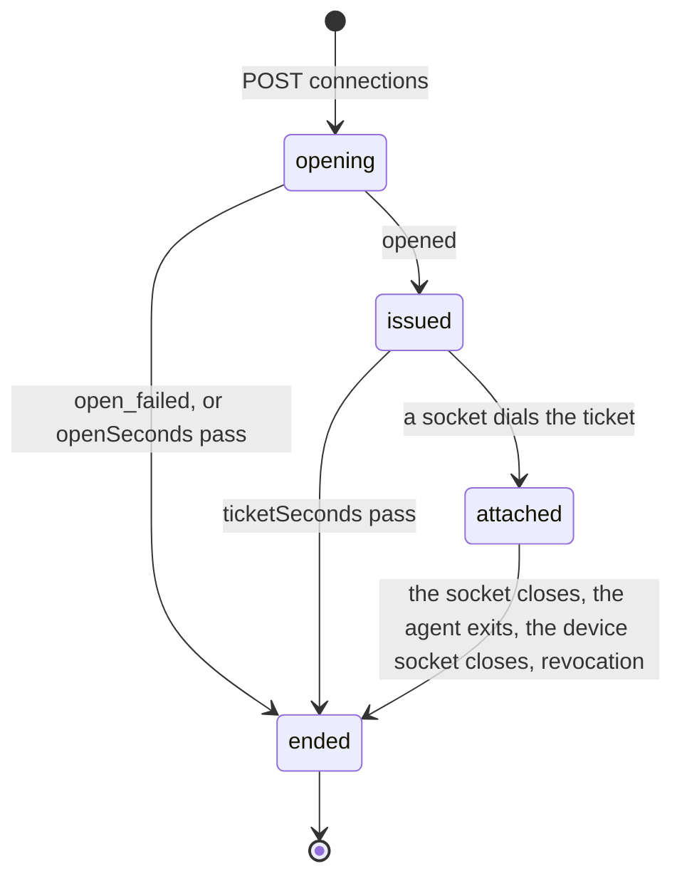

# Exterior Agent Protocol

Version 1. Draft.

Exterior Agent Protocol (EAP) lets an application reach an [Agent Client Protocol (ACP)](https://agentclientprotocol.com) agent that runs on a machine its user owns. Both sides connect to a relay. The machine never accepts an inbound connection.

The key words MUST, MUST NOT, SHOULD, SHOULD NOT and MAY are used as in RFC 2119. All JSON is UTF-8. Times are RFC 3339 in UTC.

## 1. Overview



There are two paths. The control path is HTTPS: a client lists devices and opens connections. The data path is two WebSockets joined inside the relay: the client's attach socket and the device socket. Frames travel the data path. The relay holds a frame only until it forwards it.

EAP carries ACP messages without reading them. It specifies:

- how a relay is discovered and how clients and devices sign in to it;
- how a device announces itself and its agents;
- how a client opens a connection to an agent and how the connection ends;
- the messages between relay and device;
- errors and close codes.

EAP does not specify how an account is created, how a person logs in, what a consent screen looks like, how a person chooses which devices a client may reach, how an agent is installed, or anything inside an ACP message.

## 2. Terms

**Account**: the person on whose behalf clients and devices act. The relay learns it from a token.

**Relay**: the party both other roles connect to. It keeps the set of online devices and the set of live connections, and forwards frames.

**Client**: an application that lists devices and opens connections. A client is an ACP client. A web app is a client.

**Device**: a machine's registration with one relay, and the daemon that runs under it. It connects outbound to the relay, announces its agents, and starts them on request. A device is an OAuth client, so one machine registered with two relays, or by two accounts, is two devices.

**Agent**: an ACP agent a device can start. A device offers it under an agent name.

**Connection**: one running agent process, reached through one attach socket. It is one ACP connection: one `initialize`, and as many ACP sessions as the agent supports. It ends when its socket closes, and is never resumed.

**Frame**: one WebSocket text message carrying one ACP JSON-RPC message.

**Ticket**: a single-use, short-lived secret that lets one WebSocket attach to one connection.

**Grant**: the set of devices an account has permitted a client to reach.

## 3. Discovery

A relay is identified by an origin, called the relay address. Everything else is discovered from it.

The relay MUST publish, at the relay address:

1. OAuth protected resource metadata (RFC 9728) at `/.well-known/oauth-protected-resource`, listing at least one `authorization_servers` entry, and `scopes_supported` including the scopes in section 4.1.
2. An EAP metadata document at `/.well-known/exterior-agent-protocol`:

```json
{
  "protocolVersions": [1],
  "resource": "https://relay.example.com",
  "endpoints": {
    "devices": "https://relay.example.com/eap/devices",
    "connections": "https://relay.example.com/eap/connections",
    "deviceSocket": "wss://relay.example.com/eap/device"
  },
  "limits": {
    "openSeconds": 15,
    "ticketSeconds": 60,
    "frameBytes": 1048576
  }
}
```

- `resource` is the OAuth resource indicator (RFC 8707) every token request names.
- The endpoint addresses are absolute and are the only addresses a client or device uses. A relay chooses its own paths.
- `protocolVersions` lists the versions the relay speaks. This document is version 1.
- Every address in `endpoints` speaks version 1. A later version that changes an endpoint publishes a new address for it, so the address a client calls states its version.
- Limits are the values the relay enforces and that endpoints rely on. A relay MUST advertise every limit. Recommended values are shown above.

An authorization server is discovered from the protected resource metadata, then from its own metadata (RFC 8414).

## 4. Authorization

EAP uses OAuth 2.1 bearer access tokens. Every HTTP request to an endpoint, and the device WebSocket upgrade, carries `Authorization: Bearer <token>`. The attach WebSocket carries a ticket instead.

An unauthenticated request is answered 401 with `WWW-Authenticate: Bearer resource_metadata="<address of the protected resource metadata>"`.

### 4.1 Scopes

- `eap:client`: the holder is a client. It may list devices and open connections within its grant.
- `eap:device`: the holder is a device. It may open the device WebSocket.

The relay MUST NOT accept an `eap:client` token on the device WebSocket or an `eap:device` token on a client endpoint, and MUST NOT issue both scopes to one OAuth client. A token without the required scope is answered `insufficient_scope`.

The scope names are the EAP roles. A token's OAuth client is a different thing: both a client and a device are OAuth clients.

`offline_access` MAY be requested to receive a refresh token.

### 4.2 Clients

A client signs in with the authorization code flow with PKCE (S256), requesting `eap:client` and the relay's `resource`. It identifies itself by one of: a pre-registered client id; the address of a Client ID Metadata Document; or a registration made at the authorization server's registration endpoint (RFC 7591). A relay MUST support at least one of these and advertise it in its authorization server metadata.



### 4.3 Devices

Each device is its own OAuth client, and its client id is its device id.

1. The device registers (RFC 7591) with `grant_types` `["urn:ietf:params:oauth:grant-type:device_code", "refresh_token"]`, `token_endpoint_auth_method` `none`, `scope` `eap:device offline_access`, and `client_name` set to its hostname.
2. The device signs in with the device authorization grant (RFC 8628), requesting `eap:device` and the relay's `resource`. The person approves the code.
3. The device keeps its client id across sign-outs. Signing in again with the same client id is the same device.

A relay MUST issue `eap:device` only to a client registered for the device authorization grant, and MUST refuse a sign-in of a device client by an account other than the one that holds it.

The relay derives the device id from the token's client id (`azp` or `client_id`). A device never states its own id on the wire.



### 4.4 Grants

A grant limits what a client may reach. A grant is either all of an account's devices, or a list of device ids. A granted device includes every agent it offers, including agents added to it later. How the person chooses a grant is outside EAP.

The relay MUST apply the grant to every operation:

- a device outside the grant is absent from `GET devices` and is answered `target_not_found` when named;
- when a grant narrows, the relay MUST end every connection of that client that the grant no longer permits.

A device client has no grant. It can only act as a device.

### 4.5 Removal and revocation

The relay MUST close a socket as soon as the authorization behind it ends. A socket MUST NOT outlive the authorization that opened it.

- Removing a device deletes its OAuth client. Revoking a device's authorization, such as when it signs out, ends it too. Either way the relay closes the device socket with `revoked`, which ends the device's connections (section 7).
- Revoking a client's authorization, or narrowing its grant, closes each attach socket it no longer permits with `revoked`.
- Disabling an account does both for every device and client of the account.

An access token that expires while a socket is open does not close the socket. A token is checked when an endpoint is called, when a device socket opens, and when a ticket is issued.

## 5. Errors

An error response has an HTTP status and a JSON body:

```json
{ "code": "target_not_found", "message": "That device is not online." }
```

`code` is stable and machine-readable. `message` is for people and may change. Clients MUST decide by `code`.

| Code | Status | Meaning |
| --- | --- | --- |
| `invalid_request` | 400 | A field is missing, malformed or too long. |
| `unauthorized` | 401 | The token is missing, expired or revoked. |
| `insufficient_scope` | 403 | The token's scope does not allow this endpoint. |
| `target_not_found` | 404 | The device is not online, does not offer the agent, or is outside the grant. These cases MUST NOT be distinguishable. |
| `agent_start_failed` | 502 | The device could not or would not start the agent. `message` is the device's reason. |
| `device_timeout` | 504 | The device did not answer within `openSeconds`. |
| `rate_limited` | 429 | Too many requests or connections. |
| `server_error` | 500 | The relay failed. |

## 6. HTTP API

All bodies are JSON. Names are camelCase.

### 6.1 Devices

`GET {devices}` returns the online devices within the caller's grant:

```json
{
  "devices": [
    {
      "id": "d8f0c2a1-...",
      "hostname": "studio-mac",
      "platform": "macos",
      "workingDirectory": "/Users/person/.local/share/exterior/workspace",
      "agents": [{ "name": "claude", "agentType": "claude-acp" }]
    }
  ]
}
```

- `id` is the device's client id.
- `hostname` is 1 to 256 characters.
- `platform` is `macos`, `windows` or `linux`. A client MUST tolerate other values.
- `workingDirectory` is a directory on the device, in the device's own path syntax. It is the directory the device uses when a client names none. It is a hint, not a boundary (section 12).
- `agents[].name` is unique on the device, 1 to 128 characters, with no CR, LF or tab. `agentType` matches `^[a-z][a-z0-9-]{0,63}$` and is the agent's ACP Registry id when it has one. The relay does not interpret it.

The list is a snapshot. EAP has no events: a client that wants fresh state asks again.

### 6.2 Connections

`POST {connections}` with `{ "deviceId": "...", "agentName": "..." }` opens a connection.

The relay checks the scope and the grant, finds the online device and its agent, and asks the device to start the agent. It answers after the device reports the result, or `device_timeout` after `openSeconds`. On success, 201:

```json
{
  "agentType": "claude-acp",
  "url": "wss://relay.example.com/eap/attach?ticket=...",
  "expiresAt": "2026-10-21T08:00:00Z"
}
```

`url` is the attach address, carrying the ticket. `expiresAt` is when the ticket lapses. Errors: `invalid_request`, `target_not_found`, `agent_start_failed`, `device_timeout`, `rate_limited`.



A connection has no other HTTP operation. A client ends it by closing its socket.

## 7. Connection lifecycle



- `opening`: the device was asked to start the agent.
- `issued`: the agent runs and the ticket is out. No socket is attached.
- `attached`: one socket is attached and frames flow.

A connection ends when:

- the device reports `open_failed`, or does not answer within `openSeconds`;
- its ticket is not dialed within `ticketSeconds`;
- its socket closes, for any reason;
- the agent exits (the device sends `close`);
- the device socket closes, including when the device is removed or revoked;
- the client's authorization or grant no longer permits it (section 4.5).

An attached connection has no time limit: while its socket is open, the agent may think or run a command for as long as it takes.

When a connection ends the relay tells the device to `close` it, if the device socket is open, and closes the attach socket if one is attached. The device stops the agent.

**Reconnecting.** A connection is never resumed. A client that loses its socket, and a page that reloads, opens a new connection and sends `initialize` on it. It continues a conversation with ACP `session/resume` or `session/load`, when the agent advertises them. A request that had no response when the socket closed has no outcome the client can learn. The agent was stopped, and may have done part of it.

## 8. Attach socket

A client dials the attach `url` as a WebSocket. It sends no `Authorization` header: the ticket in the address is the credential, because a browser socket cannot set one.

**Tickets.**

- A ticket is bound to one connection and is single-use: dialing it consumes it.
- It is valid for `ticketSeconds` from when it is issued, and has at least 128 bits of randomness.
- A ticket that is used, expired or unknown is answered by closing the socket with `ticket_rejected`. The ticket's connection is not affected. A client that still wants an agent opens a new connection.

A client MUST dial each ticket at most once. A client that may mount twice, such as a page under a framework that remounts components, keeps one socket per connection itself. A second dial does not reach the agent; it costs a second connection.

**Frames.**

- Each WebSocket text message is one frame, and each frame carries one ACP JSON-RPC message without a raw newline.
- Binary messages are refused: the relay closes with 1003. A frame larger than `frameBytes` closes the socket with 1009.
- The relay forwards frames in both directions one to one, in order, without joining, splitting, dropping or inspecting them.
- Frames the agent writes before the socket attaches are held by the relay and sent first, in order. A relay MAY end a connection whose held frames pass `frameBytes` in total.
- The relay MUST NOT send anything on the attach socket that is not a frame.

**Flow.** One device socket carries every connection of its device, so one slow attach socket must not stall the others. The relay MUST NOT stop reading the device socket because an attach socket is slow. When an attach socket has more unsent data than a bound the relay chooses, at least twice `frameBytes`, the relay closes it with 1013, which ends the connection.

An ACP client with a WebSocket transport can use the attach address as its agent address as it stands.

## 9. Device socket

A device opens the device WebSocket at the `deviceSocket` endpoint with a bearer token that has `eap:device`. A device has at most one device socket: a newer one closes the older with `replaced`.

Every message is a JSON text message with a `type` field. A receiver MUST ignore a message type or a field it does not know. A message carries a frame JSON-escaped, so it can be larger than the frame: a receiver MUST accept device socket messages up to `6 × frameBytes + 4096` bytes.

A message that names a `connectionId` the receiver does not hold is not an error. The relay answers it with `close` for that id, unless it is itself a `close`. The device ignores it. An `opened` that arrives after the relay gave up on the open is answered this way, so the device stops the agent.

When the device socket closes, the relay ends every connection of the device and the device stops every agent it started for them.

### 9.1 Device to relay

`hello`: sent first, and again whenever any field changes. It replaces what the relay knew about the device. Any other message before the first `hello` is invalid.

```json
{
  "type": "hello",
  "protocolVersion": 1,
  "hostname": "studio-mac",
  "platform": "macos",
  "workingDirectory": "/Users/person/.local/share/exterior/workspace",
  "agents": [{ "name": "claude", "agentType": "claude-acp" }]
}
```

`agents` lists at most 32 agents. A change to `agents` does not end running agents.

`opened`: `{ "type": "opened", "connectionId": "..." }`. The agent started.

`open_failed`: `{ "type": "open_failed", "connectionId": "...", "message": "..." }`. `message` is 1 to 500 characters.

`frame`: `{ "type": "frame", "connectionId": "...", "payload": "<frame text>" }`. `payload` is one line the agent wrote, at most `frameBytes`.

`close`: `{ "type": "close", "connectionId": "..." }`. The agent ended.

### 9.2 Relay to device

`open`: `{ "type": "open", "connectionId": "...", "agentName": "..." }`. Start that agent. The device answers `opened` or `open_failed`. It answers `open_failed` for an agent it does not offer, and MAY answer it when it already runs as many agents as it allows. An `open` for a connection id the device already holds is ignored.

`frame`: as above, from the client to the agent.

`close`: `{ "type": "close", "connectionId": "..." }`. Stop the agent.

`connectionId` is unguessable: at least 128 bits of randomness, base64url.

### 9.3 Agent carriage

The device runs the agent as an ACP stdio agent.

- A frame received from the relay is written to the agent's standard input followed by a newline. The device refuses a frame that contains a raw newline.
- The device reads standard output as UTF-8, replacing invalid sequences with U+FFFD. Each line is a frame, without its line ending: LF, or CR LF. Empty lines are dropped.
- A device ends an agent whose output line exceeds `frameBytes`. It MUST NOT stop reading the device socket because one agent is slow: it ends an agent whose unread input passes a bound it chooses.
- Standard error is not forwarded.

The working directory of the agent process is the device's `workingDirectory`. Which directory an ACP session works in is the client's request inside ACP, not an EAP field.

## 10. Heartbeat and close codes

Both socket kinds use protocol-level ping and pong. The relay MUST ping every socket, and a device MUST ping its device socket, every 30 seconds. A side whose previous ping is unanswered when the next is due MUST terminate the socket. A browser cannot send a ping; it answers the relay's.

Application close codes. Each code is unique across EAP and each socket kind has its own range, so a code identifies the socket kind and the condition in a log. The reason string is the name. Every close of an attach socket ends its connection.

Attach socket, 4100 to 4199:

| Code | Name | Meaning |
| --- | --- | --- |
| 4100 | `ticket_rejected` | The ticket is used, expired or unknown. Open a new connection. |
| 4101 | `agent_exited` | The agent ended. |
| 4102 | `device_gone` | The device socket closed, or the device was removed. |
| 4103 | `revoked` | The client's authorization or grant no longer permits this connection. Do not open another before signing in again. |

Standard codes: 1001 when the relay shuts down, 1003 and 1009 as stated in section 8, and 1013 for a socket that cannot keep up.

Device socket, 4200 to 4299:

| Code | Name | Meaning |
| --- | --- | --- |
| 4200 | `replaced` | A newer device socket for this device took over. |
| 4201 | `revoked` | The device was removed or its authorization revoked. It must sign in again. |
| 4202 | `unsupported_version` | The relay does not speak the `hello` version. |
| 4203 | `invalid_message` | The device sent a message that does not follow section 9. |

An upgrade refused before the socket opens is answered 401 or 403 as in section 4. A device told `revoked` MUST NOT reconnect until it signs in again. A device told `replaced` SHOULD wait the longest of its retry delays before connecting again.

## 11. Deployment

A relay keeps devices and connections in memory. One relay address is served by one process, or by several that route every request for a device to the process that holds its device socket. A relay that restarts ends every connection: devices connect again, and clients open new connections as in section 7.

## 12. Security considerations

**The grant is the trust boundary.** A client within its grant can run the granted devices' agents with the device owner's permissions. The relay MUST present this to the person when they choose a grant: which client and which devices, that the client can act with their permissions, and that a granted device includes agents added to it later.

**`cwd` is not a boundary.** ACP carries a working directory in `session/new` and similar requests. The device does not read ACP messages, and an agent can read any path its user can. A device that needs a boundary runs the agent inside an operating-system sandbox. ACP tool permission requests protect against a misbehaving agent, not a malicious client, because the client answers them.

**`workingDirectory` names a path.** It often contains the person's user name on the device, and every client in the grant reads it.

**The relay sees every frame in plaintext.** EAP has no end-to-end encryption. A person who does not trust a relay does not point their devices at it.

**Tickets** appear in a URL, which may be logged. They are single-use, short-lived and unguessable, and are never accepted from an `Authorization` header or a cookie. Relays SHOULD NOT log the query string of the attach address.

**Roles are separate.** The scope check in section 4.1 stops a client from posing as a device and receiving the frames of connections opened on it. A device's identity comes from its token, so one device of an account cannot take the place of another.

**Origins.** A relay SHOULD allow cross-origin calls to its endpoints only from the redirect origins registered for the calling client, and SHOULD check the `Origin` of an attach socket against them.

**Registration is open.** A relay that accepts anonymous client registration SHOULD rate limit it and delete registrations nobody approved.

**Device authorization can be phished.** The approval screen MUST name the device and the account, and the relay SHOULD show where the request came from.

**Limits.** A relay SHOULD bound connections per account and per client, and frames per second per socket.

## 13. Versioning

The version is an integer. Within a version, changes are additive: new optional fields, new message types, new error codes. A receiver ignores what it does not know, except an unknown error `code`, which it treats like `server_error`.

A device states its version in `hello`. A relay that does not speak it closes the device socket with `unsupported_version`. A client reads `protocolVersions` from the metadata document, uses the highest version it also speaks, and calls the endpoints published for that version (section 3).

## 14. Conformance

A relay, a client or a device conforms when it meets every MUST and MUST NOT in this document addressed to it. SHOULD statements are recommendations and do not affect conformance.
