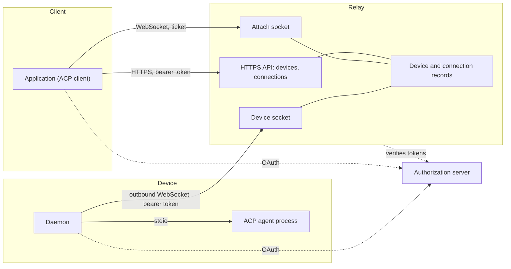
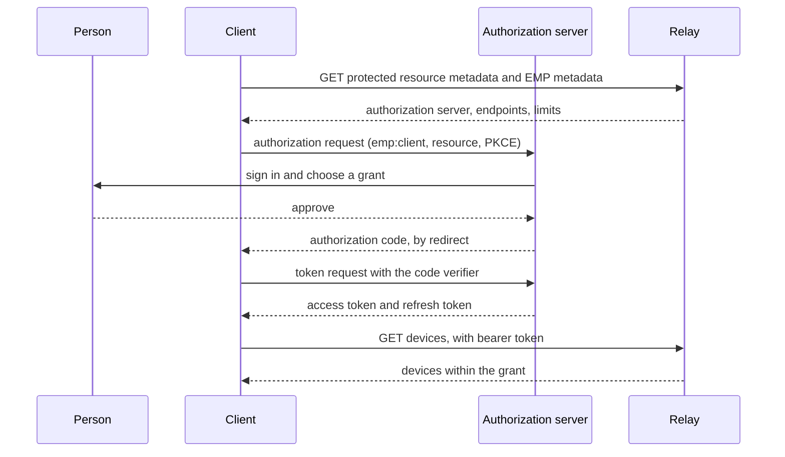
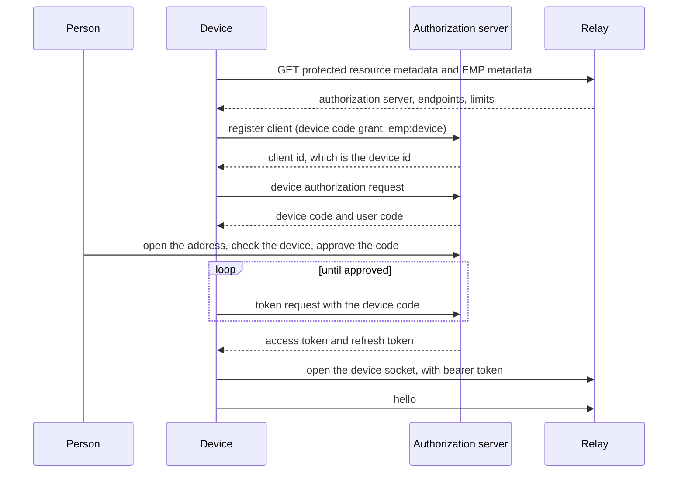
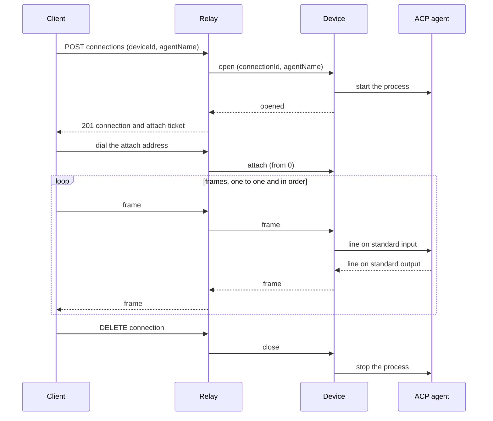
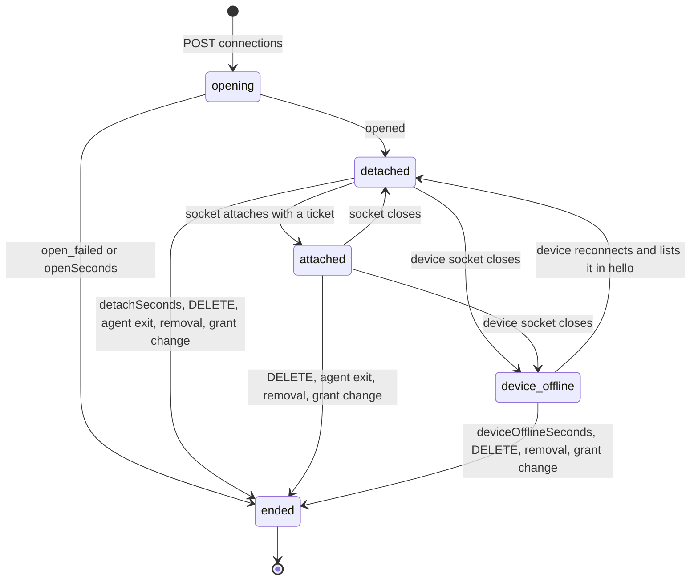
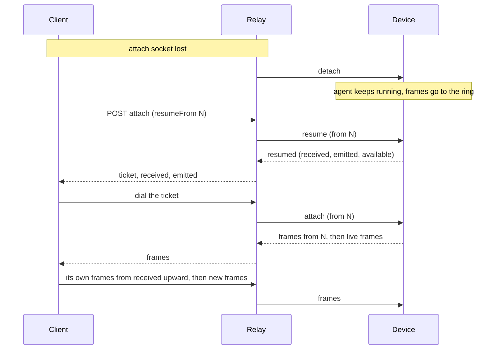
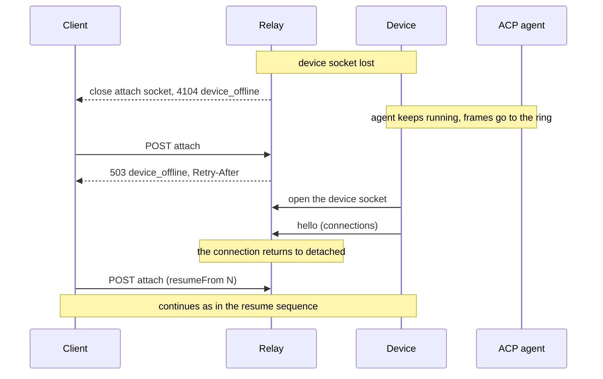

# Exterior Model Protocol

Version 1. Draft.

Exterior Model Protocol (EMP) lets an application reach an [Agent Client Protocol (ACP)](https://agentclientprotocol.com) agent that runs on a machine its user owns. Both sides connect to a relay. The machine never accepts an inbound connection.

The key words MUST, MUST NOT, SHOULD, SHOULD NOT and MAY are used as in RFC 2119. All JSON is UTF-8. Times are RFC 3339 in UTC.

## 1. Overview



There are two paths. The control path is HTTPS: a client lists devices and opens, attaches to and ends connections. The data path is two WebSockets joined inside the relay: the client's attach socket and the device socket. Frames travel the data path and are never stored by the relay.

EMP carries ACP messages without reading them. It specifies:

- how a relay is discovered and how clients and devices sign in to it;
- how a device announces itself and its agents;
- how a client opens, attaches to, resumes and ends a connection to an agent;
- the messages between relay and device;
- errors and close codes.

EMP does not specify how an account is created, how a person logs in, what a consent screen looks like, how a person chooses which devices a client may reach, how an agent is installed, or anything inside an ACP message.

## 2. Terms

**Account**: the person on whose behalf clients and devices act. The relay learns it from a token.

**Relay**: the party both other roles connect to. It keeps the set of online devices and the set of live connections, and forwards frames. It holds no frames.

**Client**: an application that lists devices and opens connections. A client is an ACP client. A web app is a client.

**Device**: a machine's registration with one relay, and the daemon that runs under it. It connects outbound to the relay, announces its agents, and starts them on request. A device is an OAuth client, so one machine registered with two relays, or by two accounts, is two devices.

**Agent**: an ACP agent a device can start. A device offers it under an agent name.

**Connection**: one running agent process reached through the relay. It is an ACP connection: one `initialize`, and as many ACP sessions as the agent supports. It has an id, belongs to one account and one client, and outlives any one socket.

**Frame**: one WebSocket text message carrying one ACP JSON-RPC message.

**Ticket**: a single-use, short-lived secret that lets one WebSocket attach to one connection.

**Grant**: the set of devices, and optionally agents, an account has permitted a client to reach.

## 3. Discovery

A relay is identified by an origin, called the relay address. Everything else is discovered from it.

The relay MUST publish, at the relay address:

1. OAuth protected resource metadata (RFC 9728) at `/.well-known/oauth-protected-resource`, listing at least one `authorization_servers` entry, and `scopes_supported` including the scopes in section 4.1.
2. An EMP metadata document at `/.well-known/exterior-model-protocol`:

```json
{
  "protocolVersions": [1],
  "resource": "https://relay.example.com",
  "endpoints": {
    "devices": "https://relay.example.com/emp/devices",
    "connections": "https://relay.example.com/emp/connections",
    "deviceSocket": "wss://relay.example.com/emp/device"
  },
  "limits": {
    "openSeconds": 15,
    "ticketSeconds": 60,
    "detachSeconds": 300,
    "deviceOfflineSeconds": 300,
    "frameBytes": 1048576,
    "ringBytes": 4194304
  }
}
```

- `resource` is the OAuth resource indicator (RFC 8707) every token request names.
- The endpoint addresses are absolute and are the only addresses a client or device uses. A relay chooses its own paths.
- `protocolVersions` lists the versions the relay speaks. This document is version 1.
- Limits are the values the relay enforces and that endpoints rely on. A relay MUST advertise every limit. Recommended values are shown above.

An authorization server is discovered from the protected resource metadata, then from its own metadata (RFC 8414).

## 4. Authorization

EMP uses OAuth 2.1 bearer access tokens. Every HTTP request to an endpoint, and the device WebSocket upgrade, carries `Authorization: Bearer <token>`. The attach WebSocket carries a ticket instead.

An unauthenticated request is answered 401 with `WWW-Authenticate: Bearer resource_metadata="<address of the protected resource metadata>"`.

### 4.1 Scopes

- `emp:client`: the holder is a client. It may list devices and open, attach to, resume and end connections within its grant.
- `emp:device`: the holder is a device. It may open the device WebSocket.

The relay MUST NOT accept an `emp:client` token on the device WebSocket or an `emp:device` token on a client endpoint, and MUST NOT issue both scopes to one OAuth client. A token without the required scope is answered `insufficient_scope`.

The scope names are the EMP roles. A token's OAuth client is a different thing: both a client and a device are OAuth clients.

`offline_access` MAY be requested to receive a refresh token.

### 4.2 Clients

A client signs in with the authorization code flow with PKCE (S256), requesting `emp:client` and the relay's `resource`. It identifies itself by one of: a pre-registered client id; the address of a Client ID Metadata Document; or a registration made at the authorization server's registration endpoint (RFC 7591). A relay MUST support at least one of these and advertise it in its authorization server metadata.



### 4.3 Devices

Each device is its own OAuth client, and its client id is its device id.

1. The device registers (RFC 7591) with `grant_types` `["urn:ietf:params:oauth:grant-type:device_code", "refresh_token"]`, `token_endpoint_auth_method` `none`, `scope` `emp:device offline_access`, and `client_name` set to its hostname.
2. The device signs in with the device authorization grant (RFC 8628), requesting `emp:device` and the relay's `resource`. The person approves the code.
3. The device keeps its client id across sign-outs. Signing in again with the same client id is the same device.

A relay MUST issue `emp:device` only to a client registered for the device authorization grant, and MUST refuse a sign-in of a device client by an account other than the one that holds it.

The relay derives the device id from the token's client id (`azp` or `client_id`). A device never states its own id on the wire.



### 4.4 Grants

A grant limits what a client may reach. A grant is either all of an account's devices, or a list of devices, each with all agents or a list of agent names. How the person chooses a grant is outside EMP.

The relay MUST apply the grant to every operation:

- a device or agent outside the grant is absent from `GET devices` and is answered `target_not_found` when named;
- when a grant narrows or is revoked, the relay MUST end every connection of that client that the grant no longer permits.

A device client has no grant. It can only act as a device.

### 4.5 Removal and revocation

Removing a device deletes its OAuth client. The relay MUST then close its device socket with `removed` and end its connections. Revoking a client's authorization ends that client's connections.

An access token that expires while a socket is open does not close the socket. A token is checked when an endpoint is called, when a device socket opens, and when a ticket is issued.

## 5. Errors

An error response has an HTTP status and a JSON body:

```json
{ "code": "target_not_found", "message": "That device is not online." }
```

`code` is stable and machine-readable. `message` is for people and may change. Clients MUST decide by `code`.

| Code | Status | Meaning |
| --- | --- | --- |
| `invalid_request` | 400 | A field is missing, malformed or too long. |
| `unauthorized` | 401 | The token is missing, expired or revoked. |
| `insufficient_scope` | 403 | The token's scope does not allow this endpoint. |
| `target_not_found` | 404 | The device is not online, does not offer the agent, or is outside the grant. These cases MUST NOT be distinguishable. |
| `connection_not_found` | 404 | The connection does not exist, has ended, or belongs to another account or client. |
| `device_offline` | 503 | The connection's device lost its link and is within `deviceOfflineSeconds`. The response carries `Retry-After`. |
| `agent_start_failed` | 502 | The device could not start the agent. `message` is the device's reason. |
| `device_timeout` | 504 | The device did not answer within `openSeconds`. |
| `resume_gap` | 409 | The requested frames are no longer held. |
| `rate_limited` | 429 | Too many requests or connections. |
| `server_error` | 500 | The relay failed. |

## 6. HTTP API

All bodies are JSON. Names are camelCase.

### 6.1 Devices

`GET {devices}` returns the online devices within the caller's grant:

```json
{
  "devices": [
    {
      "id": "d8f0c2a1-...",
      "hostname": "studio-mac",
      "platform": "macos",
      "workingDirectory": "/Users/person/.local/share/exterior/workspace",
      "agents": [{ "name": "claude", "agentType": "claude-acp" }]
    }
  ]
}
```

- `id` is the device's client id.
- `hostname` is 1 to 256 characters.
- `platform` is `macos`, `windows` or `linux`. A client MUST tolerate other values.
- `workingDirectory` is a directory on the device, in the device's own path syntax. It is the directory the device uses when a client names none. It is a hint, not a boundary (section 12).
- `agents[].name` is unique on the device, 1 to 128 characters, with no CR, LF or tab. `agentType` matches `^[a-z][a-z0-9-]{0,63}$` and is the agent's ACP Registry id when it has one. The relay does not interpret it.

The list is a snapshot. EMP has no events: a client that wants fresh state asks again.

### 6.2 Connections

A connection has this shape:

```json
{
  "id": "tN3rXk0qZ1m9Wc2yPb7aHg",
  "deviceId": "d8f0c2a1-...",
  "agentName": "claude",
  "agentType": "claude-acp",
  "state": "detached"
}
```

`id` is unguessable: at least 128 bits of randomness, base64url. `state` is one of `opening`, `attached`, `detached`, `device_offline` (section 7). An ended connection is not shown.

A response that issues a ticket includes an attach object:

```json
{ "url": "wss://relay.example.com/emp/attach?ticket=...", "expiresAt": "2026-10-21T08:00:00Z" }
```

**Open.** `POST {connections}` with `{ "deviceId": "...", "agentName": "..." }`.

The relay checks the scope and the grant, finds the online device and its agent, creates the connection and asks the device to start the agent. It answers after the device reports the result, or `device_timeout` after `openSeconds`. On success, 201:

```json
{ "connection": { ... }, "attach": { "url": "...", "expiresAt": "..." } }
```

The ticket replays the agent's frames from index 0. Errors: `target_not_found`, `agent_start_failed`, `device_timeout`, `rate_limited`.



**List.** `GET {connections}` returns `{ "connections": [ ... ] }`: the connections of the caller's account that this client opened. A page that reloaded uses it to find its agents.

**Get.** `GET {connections}/{id}` returns the connection, or `connection_not_found`.

**Attach.** `POST {connections}/{id}/attach` with an optional body `{ "resumeFrom": N }` returns a new ticket, 200:

```json
{ "attach": { "url": "...", "expiresAt": "..." }, "received": 12, "emitted": 340 }
```

- `received` is how many client frames the device has accepted for this connection.
- `emitted` is how many frames the agent has produced.
- With `resumeFrom` the socket will replay the agent's frames from index N. Without it, from `emitted`: the client joins the live stream and misses nothing from the moment of the response.
- Errors: `connection_not_found`, `device_offline`, `resume_gap`.

Attach takes a round trip to the device (section 8). Only a connection in state `detached` or `attached` can be attached to. Attaching to an `attached` connection is allowed; the new socket supersedes the old one.

**End.** `DELETE {connections}/{id}` ends the connection and its agent. 204, or `connection_not_found`.

## 7. Connection lifecycle

| State | Meaning |
| --- | --- |
| `opening` | The device was asked to start the agent. |
| `detached` | The agent runs, and no client socket is attached. |
| `attached` | One client socket is attached. |
| `device_offline` | The device socket is gone. The agent may still run on the device. |



Transitions:

- `opening` → `detached` when the device reports `opened`. `opening` ends if the device reports `open_failed` or does not answer within `openSeconds`.
- `detached` → `attached` when a socket attaches with a valid ticket.
- `attached` → `detached` when that socket closes for any reason.
- any → `device_offline` when the device socket closes. An attached client socket is closed with `device_offline`.
- `device_offline` → `detached` when the device reconnects and lists the connection in `hello`.

A connection ends when:

- the client calls `DELETE`;
- the agent exits (the device sends `close`);
- it has been `detached` for `detachSeconds`;
- it has been `device_offline` for `deviceOfflineSeconds`;
- the device is removed;
- the grant no longer permits it.

An `attached` connection has no time limit: while a client socket is open, the agent may think or run a command for as long as it takes. `detachSeconds` counts only the time since the last client socket closed, whatever the agent is doing. The relay does not see agent activity, so an agent in the middle of a long turn is ended like an idle one. Attaching a socket stops the count, and losing it starts it again from zero. `deviceOfflineSeconds` counts the time since the device socket closed in the same way.

When a connection ends the relay tells the device to `close` it, if reachable, and closes any attached socket.

Connection state is held in memory by the relay. A relay that loses it ends every connection. Clients and devices MUST handle that: a client opens a new connection and restores the conversation with ACP `session/load` or `session/resume`.

## 8. Attach socket

A client dials the attach `url` as a WebSocket. It sends no `Authorization` header: the ticket in the address is the credential, because a browser socket cannot set one.

**Tickets.**

- A ticket is bound to one connection and one `resumeFrom` position, and is single-use.
- It is valid for `ticketSeconds` and has at least 128 bits of randomness.
- A ticket used twice, expired or unknown is answered by closing the socket with `ticket_rejected`. The client then asks `POST .../attach` for a new one. A dial made by mistake, such as a double mount, therefore costs one ticket and nothing else.

**One socket.** A connection has at most one attached socket. A newer attach closes the older one with `superseded`.

**Frames.**

- Each WebSocket text message is one frame, and each frame carries one ACP JSON-RPC message without a raw newline.
- Binary messages are refused: the relay closes with 1003. A frame larger than `frameBytes` closes the socket with 1009.
- While a socket is attached the relay forwards frames in both directions one to one, in order, without joining, splitting, dropping or inspecting them.
- The relay MUST NOT send anything on the attach socket that is not a frame.

**Lifecycle.**

1. The relay consumes the ticket and tells the device `attach` with the position to replay from.
2. The device replays the agent's frames from that position, then continues live.
3. When the socket closes, the relay tells the device `detach` and the connection is `detached`.

A client that does not need to resume dials the first ticket and ignores everything in section 9. An ACP client with a WebSocket transport can use the attach address as its agent address as it stands.

## 9. Resume

Resuming lets a client survive a lost socket and a device survive a lost link without losing a frame. The two endpoints, the client and the device, own the stream. The relay forwards and keeps nothing.

**Counting.** For each connection and each direction, an endpoint numbers frames from 0 in the order they were sent. Numbers are implicit: they do not appear on the wire.

- The device counts frames the agent produced: `emitted`.
- The client counts frames it received on any socket of this connection: its resume position.
- The client counts frames it sent: `sent`.
- The device counts frames it accepted from the relay for the agent: `received`.

**Rings.** Each endpoint keeps the most recent frames it sent, at least `ringBytes` of them. A frame that has left the ring cannot be replayed.

**Resume sequence.**

1. The socket is lost. The client MAY have received N agent frames.
2. The client calls `POST .../attach` with `{ "resumeFrom": N }`.
3. The relay asks the device `resume`. The device answers with `received`, `emitted` and whether frame N is still held.
4. If it is not held, the relay answers `resume_gap`. The connection cannot be resumed without loss. The client SHOULD end it and open a new one.
5. Otherwise the relay answers with the ticket, `received` and `emitted`.
6. The client dials the ticket. The device replays its frames from N, then continues live.
7. Before sending anything new, the client sends again the frames numbered `received` and above that its own ring holds. If its ring no longer holds them, the client MUST end the connection.



The device keeps counting while no socket is attached and keeps its frames in the ring. The relay keeps none.

**Device link loss.** If the device socket closes, the device keeps its agents for at most `deviceOfflineSeconds` and keeps counting. When it reconnects, it lists the connections it holds in `hello`. The relay returns each to `detached`, and clients resume as above. During the window `POST .../attach` answers `device_offline` with `Retry-After`.



A device ends an agent at once when it is stopped by its owner, when it is told to `close`, or when its window passes.

## 10. Device socket

A device opens the device WebSocket at the `deviceSocket` endpoint with a bearer token that has `emp:device`. A device has at most one device socket: a newer one closes the older with `replaced`.

Every message is a JSON text message with a `type` field. A receiver MUST ignore a message type or a field it does not know.

### 10.1 Device to relay

`hello`: sent first, and again whenever any field changes. It replaces what the relay knew.

```json
{
  "type": "hello",
  "protocolVersion": 1,
  "hostname": "studio-mac",
  "platform": "macos",
  "workingDirectory": "/Users/person/.local/share/exterior/workspace",
  "agents": [{ "name": "claude", "agentType": "claude-acp" }],
  "connections": ["tN3rXk0qZ1m9Wc2yPb7aHg"]
}
```

`connections` lists every connection whose agent the device still runs. The relay returns the matching `device_offline` connections to `detached`, ends the other `device_offline` connections of the device, and answers `close` for any listed id it does not know. A change to `agents` does not end running agents.

`opened`: `{ "type": "opened", "connectionId": "..." }`. The agent started.

`open_failed`: `{ "type": "open_failed", "connectionId": "...", "message": "..." }`. `message` is 1 to 500 characters.

`frame`: `{ "type": "frame", "connectionId": "...", "payload": "<frame text>" }`. `payload` is the frame exactly as the agent wrote it, at most `frameBytes`.

`resumed`: `{ "type": "resumed", "connectionId": "...", "received": 12, "emitted": 340, "available": true }`. The answer to `resume`.

`close`: `{ "type": "close", "connectionId": "..." }`. The agent ended, or the device does not hold the connection.

### 10.2 Relay to device

`open`: `{ "type": "open", "connectionId": "...", "agentName": "..." }`. Start that agent. The device answers `opened` or `open_failed`.

`frame`: as above, from the client to the agent.

`resume`: `{ "type": "resume", "connectionId": "...", "from": 0 }`. Answer with `resumed`. `available` is true when frames from `from` are still held. This does not change any state.

`attach`: `{ "type": "attach", "connectionId": "...", "from": 0 }`. A client socket is attached. Send frames from index `from`, then live frames.

`detach`: `{ "type": "detach", "connectionId": "..." }`. No socket is attached. Stop sending `frame` for the connection, keep them in the ring.

`close`: `{ "type": "close", "connectionId": "..." }`. End the agent.

### 10.3 Agent carriage

The device runs the agent as an ACP stdio agent. A frame received from the relay is written to the agent's standard input followed by a newline. Each line the agent writes to standard output is a frame. Standard error is not forwarded. The device refuses a frame that contains a raw newline, and ends an agent whose output line exceeds `frameBytes`.

The working directory of the agent process is the device's `workingDirectory`. Which directory an ACP session works in is the client's request inside ACP, not an EMP field.

## 11. Heartbeat and close codes

Both WebSocket kinds use protocol-level ping and pong. A relay SHOULD ping every 30 seconds. A side that has not answered the previous ping when the next is due MUST be treated as gone, and its socket terminated.

Application close codes. Each code is unique across EMP and each socket kind has its own range, so a code identifies the socket kind and the condition in a log. The reason string is the name.

Attach socket, 4100 to 4199:

| Code | Name | Meaning |
| --- | --- | --- |
| 4100 | `ticket_rejected` | The ticket is used, expired or unknown. Ask for a new one. |
| 4101 | `superseded` | A newer socket attached to this connection. |
| 4102 | `agent_exited` | The agent ended. The connection is over. |
| 4103 | `connection_ended` | The connection ended for another reason. |
| 4104 | `device_offline` | The device lost its link. Retry attach. |

A relay MAY close a socket that cannot keep up with 1013. The connection becomes `detached` and can be resumed. Standard codes 1003 and 1009 apply as stated in section 8.

Device socket, 4200 to 4299:

| Code | Name | Meaning |
| --- | --- | --- |
| 4200 | `replaced` | A newer device socket for this device took over. |
| 4201 | `removed` | The device was removed. It must sign in again. |
| 4202 | `unsupported_version` | The relay does not speak the `hello` version. |
| 4203 | `invalid_message` | The device sent a message that does not follow section 10. |

An upgrade refused before the socket opens is answered 401 or 403 as in section 4. A device told `removed` MUST NOT reconnect until it signs in again. A device told `replaced` SHOULD wait the longest of its retry delays before connecting again.

## 12. Security considerations

**The grant is the trust boundary.** A client within its grant can run any of the granted agents with the device owner's permissions. The relay MUST present this to the person when they choose a grant: which client, which devices and agents, and that the client can act with their permissions.

**`cwd` is not a boundary.** ACP carries a working directory in `session/new` and similar requests. The device does not read ACP messages, and an agent can read any path its user can. A device that needs a boundary runs the agent inside an operating-system sandbox. ACP tool permission requests protect against a misbehaving agent, not a malicious client, because the client answers them.

**The relay sees every frame in plaintext.** EMP has no end-to-end encryption. A person who does not trust a relay does not point their devices at it.

**Tickets** appear in a URL, which may be logged. They are single-use, short-lived and unguessable, and are never accepted from an `Authorization` header or a cookie. Relays SHOULD NOT log the query string of the attach address.

**Roles are separate.** The scope check in section 4.1 stops a client from posing as a device and receiving the frames of connections opened on it. A device's identity comes from its token, so one device of an account cannot take the place of another.

**Origins.** A relay SHOULD allow cross-origin calls to its endpoints only from the redirect origins registered for the calling client, and SHOULD check the `Origin` of an attach socket against them.

**Registration is open.** A relay that accepts anonymous client registration SHOULD rate limit it and delete registrations nobody approved.

**Device authorization can be phished.** The approval screen MUST name the device and the account, and the relay SHOULD show where the request came from.

**Limits.** A relay SHOULD bound connections per account and per client, and frames per second per socket.

## 13. Versioning

The version is an integer. Within a version, changes are additive: new optional fields, new message types, new error codes. A receiver ignores what it does not know, except an unknown error `code`, which it treats like `server_error`.

A device states its version in `hello`. A relay that does not speak it closes the device socket with `unsupported_version`. A client reads `protocolVersions` from the metadata document and uses the highest version it also speaks.

## 14. Conformance

A relay conforms when it meets every MUST and SHOULD in this document addressed to it. A client conforms when it uses only discovered addresses, decides by error `code`, and follows sections 8 and 9 when it resumes. A device conforms when it follows sections 4.3, 9 and 10.

An endpoint that skips resume still conforms: it dials, uses the connection until the socket drops, and opens another.
